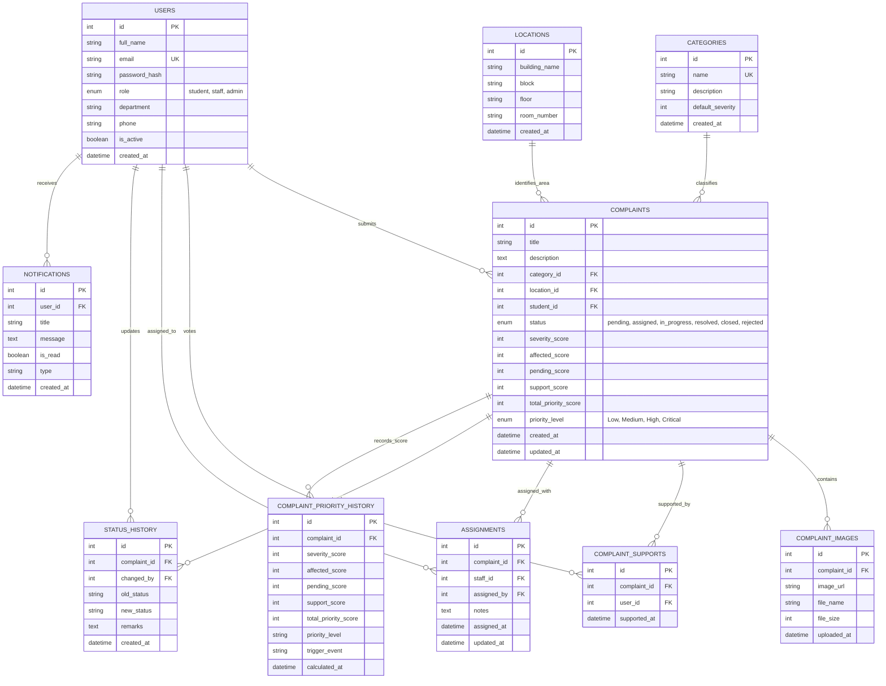

# CampusCare: Entity-Relationship Diagram & Database Design

## 1. Relational Entity Overview

---

## 2. Table Cardinalities & Constraints

1. **Users $\rightarrow$ Complaints**: One-to-Many (`1:N`). One student can submit multiple complaints. If a user is removed, complaints cascade or are preserved according to institutional policy.
2. **Categories $\rightarrow$ Complaints**: One-to-Many (`1:N`). Categories cannot be deleted if associated complaints exist (`ON DELETE RESTRICT`).
3. **Locations $\rightarrow$ Complaints**: One-to-Many (`1:N`). Locations cannot be deleted if referenced by active complaints (`ON DELETE RESTRICT`).
4. **Complaints $\rightarrow$ Complaint Images**: One-to-Many (`1:N`). If complaint is deleted, images cascade (`ON DELETE CASCADE`).
5. **Complaints $\rightarrow$ Complaint Supports**: Many-to-Many (`N:M`) between Users and Complaints. Enforced with unique composite constraint `uq_complaint_user_support (complaint_id, user_id)` preventing duplicate votes.
6. **Complaints $\rightarrow$ Assignments**: One-to-One / Unique (`1:1`). Each complaint has one active staff assignment ticket.
7. **Complaints $\rightarrow$ Status History**: One-to-Many (`1:N`). Maintains an append-only audit trail of status transitions.
8. **Complaints $\rightarrow$ Complaint Priority History**: One-to-Many (`1:N`). Tracks dynamic priority score evolution over time.
